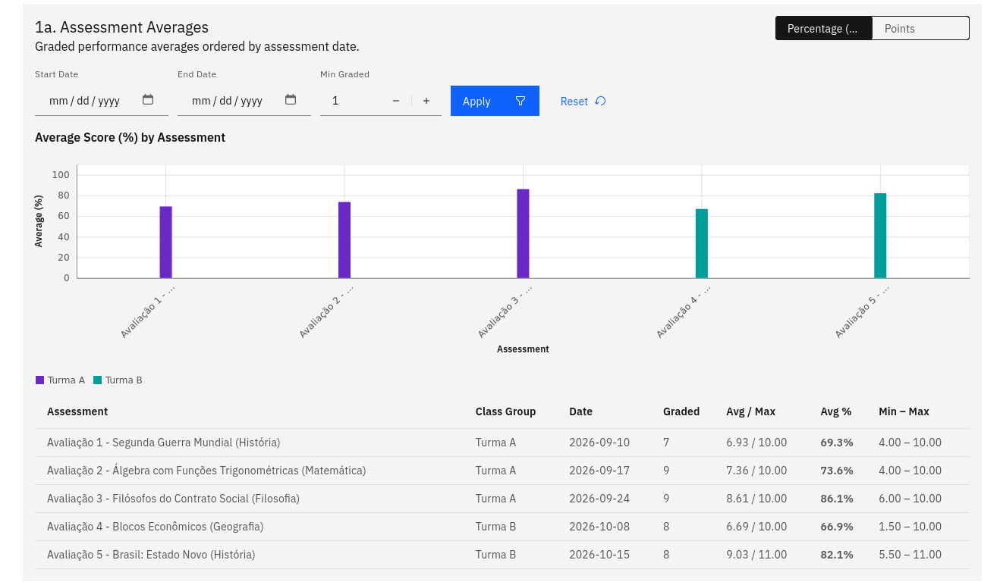
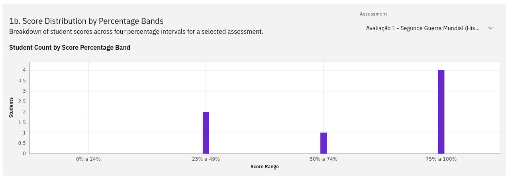
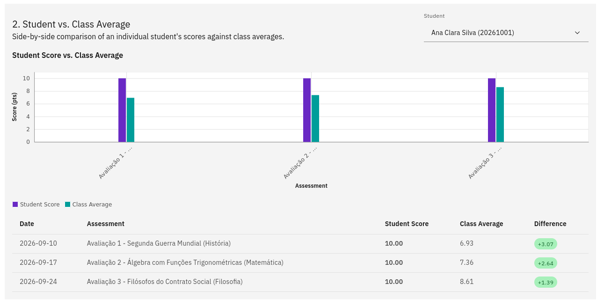
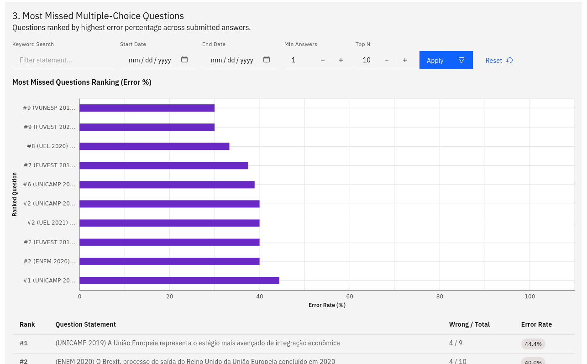

# Sistema de Avaliações
## Renan Ricci

**Natureza:** avaliação de aprendizagem (provas, simulados e quizzes).
**Particularidade:** cada questão tem um valor (`points`) dentro da avaliação. O sistema registra a nota obtida em cada questão, calculada automaticamente nas objetivas e dada pelo professor nas discursivas, e calcula a nota total de cada aluno (view `assignment_total_score`).

## Tecnologias

| Camada | Tecnologia |
|---|---|
| Banco de dados | PostgreSQL 13 |
| Back-end | Java com Spring, acesso ao banco por JDBC |
| Front-end | React + TypeScript, com Vite |

## Estrutura do repositório

```
README.md
docs/
  DER.png            diagrama entidade-relacionamento
  esquema.md         esquema relacional, regras de negócio e justificativa da 3FN
  img/               imagens das telas dos relatórios
database/
  schema.sql         cria o banco do zero, com restrições, gatilhos e view
  carga.sql          dados de teste
  relatorios.sql     consultas dos relatórios
backend/             API (controllers, model, DAOs)
frontend/            telas
```

## Como rodar

### 1. Pré-requisitos

- PostgreSQL 13 ou superior (o esquema usa `gen_random_uuid()`)
- JDK 21 ou superior
- Node.js 20 ou superior

### 2. Banco de dados

```bash
sudo -u postgres psql -c "CREATE USER bd1_user WITH PASSWORD 'bd1_password';"
sudo -u postgres psql -c "CREATE DATABASE bd1_db OWNER bd1_user;"
sudo -u postgres psql -c "GRANT ALL PRIVILEGES ON DATABASE bd1_db TO bd1_user;"

psql -h localhost -U bd1_user -W -d bd1_db -f database/schema.sql
psql -h localhost -U bd1_user -W -d bd1_db -f database/carga.sql
```

O `carga.sql` cria 25 usuários (5 professores e 20 alunos), 2 turmas, 5 avaliações, 32 questões e as respostas dos alunos.

### 3. Back-end

```bash
cd backend
./mvnw spring-boot:run
```

Localização da API: `http://localhost:8080`

### 4. Front-end

```bash
cd frontend
npm install
npm run dev
```

Localização da interface: `http://localhost:5173`

## Relatórios

```bash
psql -h localhost -U bd1_user -W -d bd1_db -f database/relatorios.sql
```

### Relatório 1: Média e distribuição das notas por avaliação

**Objetivo:** mostrar a média de cada avaliação (em pontos e em percentual da nota máxima) e como as notas dos alunos se distribuem em faixas, para comparar o rendimento entre avaliações. Gráfico de barras.




**Recursos SQL:** junção interna, junção externa (`LEFT JOIN`), agregação (`COUNT`, `AVG`, `MIN`, `MAX`), `GROUP BY`, `HAVING`, subconsulta e filtro por intervalo de datas.

Média por avaliação:

```sql
SELECT
  a.id AS assessment_id,
  a.title,
  COALESCE(cg.name, 'Sem turma') AS class_group,
  a.assessment_date,
  COUNT(*) AS graded_count,
  ROUND(AVG(s.total_score), 2) AS average_score,
  m.max_score,
  ROUND(100 * AVG(s.total_score) / m.max_score, 1) AS average_percent,
  MIN(s.total_score) AS lowest_score,
  MAX(s.total_score) AS highest_score
FROM assignment_total_score s
JOIN assessment a ON a.id = s.assessment_id
LEFT JOIN class_group cg ON cg.id = a.class_group_id
JOIN (SELECT assessment_id, SUM(points) AS max_score FROM assessment_item GROUP BY assessment_id) m ON m.assessment_id = a.id
WHERE s.status = 'GRADED' AND a.assessment_date BETWEEN :start_date AND :end_date
GROUP BY a.id, a.title, cg.name, a.assessment_date, m.max_score
HAVING COUNT(*) >= :min_graded
ORDER BY a.assessment_date;
```

Distribuição das notas de uma avaliação:

```sql
SELECT
  b.label AS score_range,
  COUNT(g.student_id) AS student_count
FROM (VALUES
  (1, '0% a 24%', 0, 25),
  (2, '25% a 49%', 25, 50),
  (3, '50% a 74%', 50, 75),
  (4, '75% a 100%', 75, 101)
) AS b(band_order, label, lower_percent, upper_percent)
LEFT JOIN (
  SELECT s.student_id, 100 * s.total_score / m.max_score AS percent
  FROM assignment_total_score s
  JOIN (SELECT assessment_id, SUM(points) AS max_score FROM assessment_item GROUP BY assessment_id) m ON m.assessment_id = s.assessment_id
  WHERE s.assessment_id = :assessment_id AND s.status = 'GRADED'
) g ON g.percent >= b.lower_percent AND g.percent < b.upper_percent
GROUP BY b.band_order, b.label
ORDER BY b.band_order;
```

### Relatório 2: Desempenho de um aluno comparado com a média da turma

**Objetivo:** comparar a nota de um aluno em cada avaliação com a média da turma naquela avaliação. Gráfico de barras lado a lado.



**Recursos SQL:** junção interna, subconsulta (em `LATERAL`), agregação (`AVG`) e ordenação.

```sql
SELECT
  a.assessment_date,
  a.title,
  s.total_score AS student_score,
  c.class_average,
  ROUND(s.total_score - c.class_average, 2) AS difference
FROM assignment_total_score s
JOIN assessment a ON a.id = s.assessment_id
CROSS JOIN LATERAL (
  SELECT ROUND(AVG(o.total_score), 2) AS class_average
  FROM assignment_total_score o
  WHERE o.assessment_id = s.assessment_id AND o.status = 'GRADED'
) c
WHERE s.student_id = :student_id AND s.status = 'GRADED'
ORDER BY a.assessment_date;
```

### Relatório 3: Questões objetivas mais erradas

**Objetivo:** listar as questões objetivas com maior percentual de erro, para identificar os conteúdos com mais dificuldade. Ranking exibido em tabela e gráfico de barras.



**Recursos SQL:** junção interna, agregação (`COUNT` com `FILTER`), `GROUP BY`, `HAVING`, ranking (`RANK`, `ORDER BY`, `FETCH FIRST`) e filtros (`IN`, `LIKE`, `BETWEEN`).

```sql
SELECT
  RANK() OVER (ORDER BY COUNT(*) FILTER (WHERE ans.score < i.points)::numeric / COUNT(*) DESC) AS error_rank,
  q.id AS question_id,
  LEFT(q.statement, 90) AS statement,
  COUNT(*) AS answer_count,
  COUNT(*) FILTER (WHERE ans.score < i.points) AS wrong_count,
  ROUND(100.0 * COUNT(*) FILTER (WHERE ans.score < i.points) / COUNT(*), 1) AS error_percent
FROM answer ans
JOIN assessment_item i ON i.assessment_id = ans.assessment_id AND i.question_id = ans.question_id
JOIN question q ON q.id = ans.question_id
JOIN assessment a ON a.id = ans.assessment_id
JOIN assignment asg ON asg.assessment_id = ans.assessment_id AND asg.student_id = ans.student_id
WHERE q.type = 'MULTIPLE_CHOICE'
  AND asg.status IN ('SUBMITTED', 'GRADED')
  AND ans.score IS NOT NULL
  AND a.assessment_date BETWEEN :start_date AND :end_date
  AND LOWER(q.statement) LIKE '%' || LOWER(:search) || '%'
GROUP BY q.id, q.statement
HAVING COUNT(*) >= :min_answers
ORDER BY error_rank, q.statement
FETCH FIRST :top_n ROWS ONLY;
```
